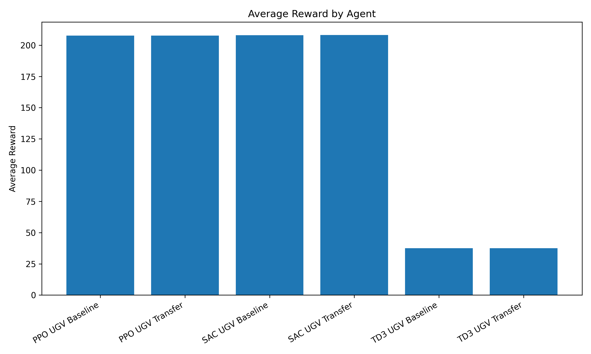
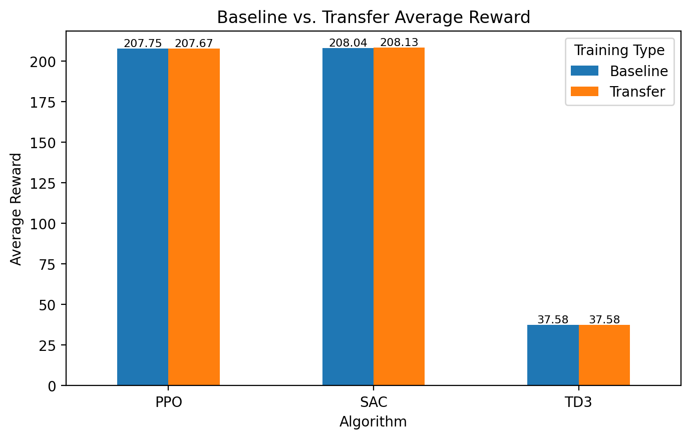
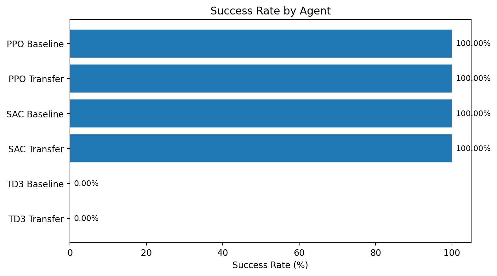

# Cross-Domain Reinforcement Learning for UAV-to-UGV Navigation

A simulation-based reinforcement learning project comparing **Proximal Policy Optimization (PPO)**, **Soft Actor-Critic (SAC)**, and **Twin Delayed DDPG (TD3)** on a simplified two-dimensional navigation task.

The project investigates whether initializing a ground-vehicle (UGV) policy with weights learned by an aerial-vehicle (UAV) policy can improve subsequent UGV training. The original experiments compare agents trained from scratch against agents initialized with transferred UAV policy weights.

> **Project Status:** Original experiment preserved; code-quality and testing improvements are in progress. These are simplified point-navigation environments, not obstacle-avoidance or high-fidelity robotics simulations.

---

## Overview

The original experiment has three stages:

1. Train PPO, SAC, and TD3 policies in the UAV environment.
2. Train baseline PPO, SAC, and TD3 policies from scratch in the UGV environment.
3. Initialize new UGV policies from UAV policy weights and continue training in the UGV environment.

The goal is to compare UGV baseline and transfer performance and study whether prior training provides a useful initialization. The recorded evaluation does not establish a meaningful transfer-learning advantage.

---

## Key Features

- Custom Gymnasium UAV and UGV navigation environments
- PPO, SAC, and TD3 training scripts using Stable-Baselines3
- UGV training from scratch and UAV-to-UGV policy-weight initialization
- Automated tests for environment behavior and policy-weight transfer
- Evaluation of reward, success rate, episode length, and out-of-bounds rate
- CSV-based result plotting and documented historical evaluation results

---

## Environment Design

Both environments expose six observation values: **X position, Y position, X velocity, Y velocity, goal X, and goal Y**. Each action has two continuous values in the range `[-1, 1]`.

### UAV Environment

**File:** `src/envs/drone_env.py`

The UAV is a simplified 2D point-mass model. Its two actions change X and Y acceleration, which updates velocity and position.

Velocity is clipped to a defined range. The agent receives a reward for reducing distance to the goal, with a small action penalty, a success bonus, and an out-of-bounds penalty.

### UGV Environment

**File:** `src/envs/ugv_env.py`

The UGV uses a similar 2D model with different acceleration and velocity limits.

Its actions are named `throttle` and `steer`, but they independently change X and Y velocity. The model does not currently simulate vehicle heading, wheel dynamics, or physical steering.

### Shared Environment Properties

In both environments:

- The agent starts at `(0, 0)`.
- The goal is fixed at `(8, 8)`.
- Episodes have a maximum of 200 steps.
- Episodes terminate when the agent reaches the goal or leaves the world boundary.
- There are currently no obstacles or randomized starting positions and goals.

These simplified environments were designed for initial comparisons between baseline and transfer-learning agents.

---

## Algorithms and Transfer Method

| Algorithm | Learning Type | Role in Project |
|---|---|---|
| PPO | On-policy | Continuous-control baseline and transfer experiment |
| SAC | Off-policy | Entropy-regularized continuous-control baseline and transfer experiment |
| TD3 | Off-policy | Twin-critic continuous-control baseline and transfer experiment |

Transfer learning copies trained UAV **policy parameters** into a newly initialized UGV model of the same algorithm, then continues training in the UGV environment.

The implementation verifies parameter-name compatibility using strict weight loading.

This approach uses policy-weight initialization and fine-tuning. It does not transfer replay-buffer experience or demonstrate real-world sim-to-real transfer.

---

## Repository Structure

```text
rl-tl-drone-to-ugv/
├── README.md
├── requirements.txt
├── requirements-dev.txt
├── .gitignore
│
├── src/
│   ├── envs/
│   │   ├── drone_env.py
│   │   └── ugv_env.py
│   │
│   ├── train/
│   │   ├── train_drone_ppo.py
│   │   ├── train_drone_sac.py
│   │   ├── train_drone_td3.py
│   │   ├── train_ugv_baseline.py
│   │   ├── train_ugv_sac.py
│   │   ├── train_ugv_td3.py
│   │   ├── train_ugv_transfer.py
│   │   ├── train_ugv_sac_transfer.py
│   │   └── train_ugv_td3_transfer.py
│   │
│   ├── models/
│   │   └── transfer_utils.py
│   │
│   └── eval/
│       ├── evaluate_agent.py
│       └── plot_results.py
│
├── tests/
│   ├── test_drone_env.py
│   ├── test_ugv_env.py
│   └── test_transfer_utils.py
│
├── results/
│   ├── evaluation_results.csv
│   ├── evaluation_summary.md
│   ├── raw_evaluation_output.txt
│   └── plots/
│       ├── average_reward_comparison.png
│       ├── baseline_vs_transfer_reward.png
│       └── success_rate_comparison.png
│
├── docs/
│   └── project_notes.md
│
└── configs/
```

---

## Installation

Python **3.12.3 on Windows** was used for the documented development tests.

### 1. Clone the Repository

```bash
git clone https://github.com/alexvarg565/rl-tl-drone-to-ugv.git
cd rl-tl-drone-to-ugv
```

### 2. Create a Virtual Environment

```bash
python -m venv .venv
```

### 3. Activate the Virtual Environment

**Windows PowerShell:**

```powershell
.\.venv\Scripts\Activate.ps1
```

**macOS / Linux:**

```bash
source .venv/bin/activate
```

### 4. Install Dependencies

For regular use:

```bash
python -m pip install -r requirements.txt
```

For development and testing:

```bash
python -m pip install -r requirements-dev.txt
```

---

## Training Workflow

Run these commands from the repository root.

Train the corresponding UAV model before running its UGV transfer script. Training saves model artifacts under `models/`.

### 1. UAV Training

Train PPO, SAC, and TD3 agents in the UAV navigation environment.

```bash
python -m src.train.train_drone_ppo
python -m src.train.train_drone_sac
python -m src.train.train_drone_td3
```

### 2. UGV Baseline Training

Train separate UGV agents from scratch to establish baseline performance.

```bash
python -m src.train.train_ugv_baseline
python -m src.train.train_ugv_sac
python -m src.train.train_ugv_td3
```

### 3. UAV-to-UGV Transfer Training

Initialize UGV agents using UAV-trained policy weights and continue training on the UGV environment.

```bash
python -m src.train.train_ugv_transfer
python -m src.train.train_ugv_sac_transfer
python -m src.train.train_ugv_td3_transfer
```

---

## Testing

The repository includes automated tests for the UAV and UGV environments and the PPO, SAC, and TD3 policy-weight transfer utilities.

The current test suite contains **19 passing tests**.

Tests cover:

- Environment reset behavior and observations
- Movement physics and action clipping
- Goal-reaching success conditions
- Boundary failures
- Episode truncation
- Policy-weight copying for PPO, SAC, and TD3
- Missing-model error handling

Run all tests using:

```bash
python -m pytest tests/ -v
```

These tests verify code behavior. They do not reproduce historical training runs or establish that transferred policies outperform baselines.

### Verified Development Environment

The tests were run using the following environment:

| Package | Tested Version |
|---|---|
| Python | 3.12.3 |
| Gymnasium | 1.2.3 |
| Stable-Baselines3 | 2.8.0 |
| PyTorch | 2.11.0 |
| NumPy | 2.4.4 |
| pandas | 3.0.2 |
| Matplotlib | 3.10.8 |
| PyYAML | 6.0.3 |
| TensorBoard | 2.20.0 |
| pytest | 9.2.0 |

These versions describe the current tested development environment, not necessarily the versions used to produce the original results.

The main `requirements.txt` is not fully version-locked.

---

## Evaluation

After training or obtaining the expected saved model files, run:

```bash
python -m src.eval.evaluate_agent
```

The evaluator prints per-agent metrics to the terminal and skips missing models.

It does not automatically regenerate `results/evaluation_results.csv`. That CSV contains the saved historical measurements used for the plots.

To regenerate the plots from the saved CSV:

```bash
python -m src.eval.plot_results
```

### Evaluation Metrics

The project records:

- Average reward
- Success rate
- Average episode length
- Out-of-bounds rate
- Baseline versus transfer-learning performance

These measurements provide an initial comparison of agent behavior under the original evaluation conditions.

---

## Historical Results

The following results are preserved from the original experiment.

They reflect **10 deterministic evaluation episodes per agent on the same fixed navigation scenario**, rather than ten independent navigation scenarios.

| Agent | Training Type | Average Reward | Success Rate | Avg Episode Length | Out-of-Bounds Rate |
|---|---|---:|---:|---:|---:|
| PPO UGV Baseline | From scratch | 207.75 | 100.00% | 65.00 | 0.00% |
| PPO UGV Transfer | UAV-to-UGV transfer | 207.67 | 100.00% | 65.00 | 0.00% |
| SAC UGV Baseline | From scratch | 208.04 | 100.00% | 66.00 | 0.00% |
| SAC UGV Transfer | UAV-to-UGV transfer | 208.13 | 100.00% | 69.00 | 0.00% |
| TD3 UGV Baseline | From scratch | 37.58 | 0.00% | 76.00 | 100.00% |
| TD3 UGV Transfer | UAV-to-UGV transfer | 37.58 | 0.00% | 76.00 | 100.00% |

For more details, see [`results/evaluation_summary.md`](results/evaluation_summary.md).

### Evaluation Plots

**Average Reward Comparison**



**Baseline vs. Transfer Average Reward**



**Success Rate Comparison**



---

## Main Findings

### PPO and SAC

PPO and SAC achieved successful goal navigation in the fixed evaluation scenario.

Both baseline and transfer-learning agents reached a 100% success rate with no recorded out-of-bounds failures.

However, their baseline and transfer results were very similar.

### TD3

Both TD3 variants failed to reach the goal during the recorded evaluation and instead left the environment boundaries.

This suggests that TD3's training configuration or learned behavior requires further investigation and tuning for this setup.

### Transfer-Learning Effectiveness

The original evaluation did not demonstrate a meaningful improvement from UAV-to-UGV transfer learning.

PPO baseline and transfer results were nearly identical. SAC transfer produced a slightly higher average reward but required more steps on average.

These observations do not establish improved sample efficiency, training stability, or generalization.

Further experiments with controlled random seeds, varied navigation scenarios, and additional training comparisons are needed.

---

## Limitations and Reproducibility

This project is an early simulation-based research prototype.

### Fixed Evaluation Conditions

The original evaluations use fixed starting conditions and goals with deterministic policy actions.

Repeated evaluation episodes therefore test the same navigation scenario rather than measuring performance across unseen environments.

### Simplified Robot Dynamics

The UAV and UGV are represented using simplified two-dimensional navigation models.

The environments do not yet include:

- Obstacle collision
- Sensor observations
- Vehicle heading or realistic steering
- Sensor noise or localization uncertainty
- Higher-fidelity robotic physics

### Experimental Reproducibility

The original training experiments lack fully documented random seeds, exact dependency versions, and repeated trials across independent seeds.

Consequently, exact reproduction of the historical training results cannot be guaranteed.

### Transfer-Learning Scope

The current transfer-learning approach copies policy parameters between models using the same algorithm.

Successful parameter transfer does not necessarily imply improved learning performance.

### Model Artifacts

Training is required to generate the expected model checkpoints before running the evaluator. The original public source snapshot does not include the trained model archives.

---

## Future Improvements

The original experiment and its results will remain preserved while future versions introduce more advanced robotics and reinforcement learning functionality.

### Phase 2 — Advanced Navigation Environments

- Randomize starting positions and goal locations
- Introduce obstacles and collision detection
- Improve UGV movement using more realistic vehicle dynamics
- Add navigation visualization and trajectory rendering
- Expand observation and reward design

### Phase 3 — Reinforcement Learning Experiments

- Retrain PPO, SAC, and TD3 on the revised environments
- Introduce controlled random seeds
- Compare performance across multiple navigation scenarios
- Evaluate zero-shot transfer and transfer fine-tuning
- Record learning curves and convergence behavior
- Measure transfer-learning effectiveness more rigorously

### Longer-Term Improvements

- Explore ROS 2 integration
- Test policies in higher-fidelity simulation environments
- Add navigation demonstrations and videos
- Expand automated testing and continuous integration
- Improve experiment configuration and reproducibility

---

## Author

**Alexander Vargas**  
Computer Engineering Student  
California State University, San Bernardino  

GitHub: [alexvarg565](https://github.com/alexvarg565)