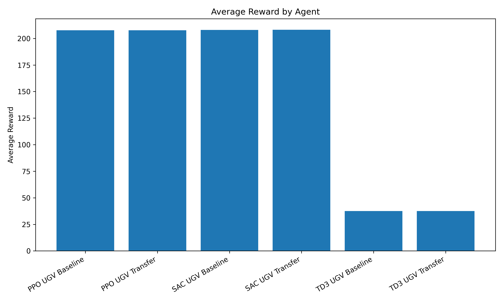
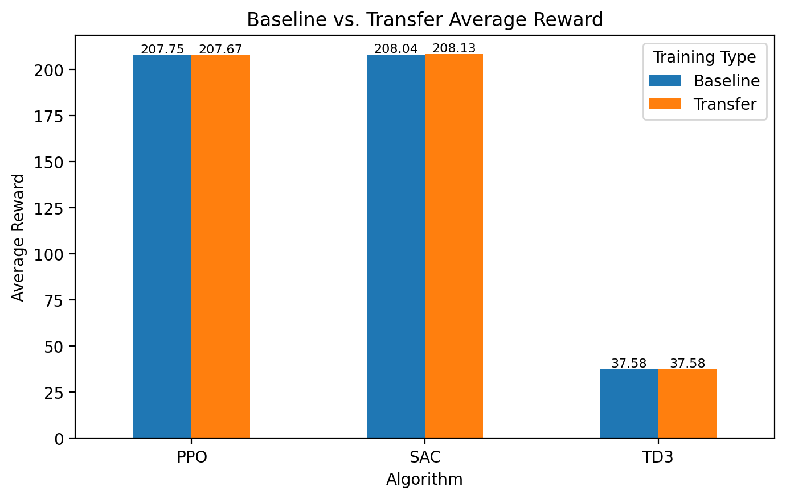
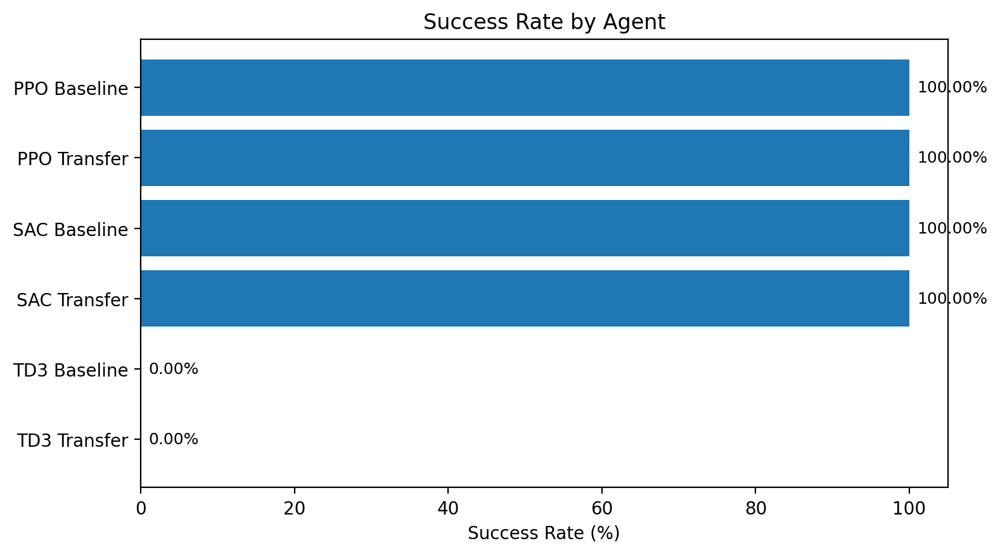

# Evaluation Summary

This document summarizes the original evaluation results for the UAV-to-UGV reinforcement learning transfer project.

## Evaluation Goal

Compare the performance of UGV agents trained from scratch against UGV agents initialized using policy weights learned in the UAV environment.

The experiment evaluated:

- Proximal Policy Optimization (PPO)
- Soft Actor-Critic (SAC)
- Twin Delayed DDPG (TD3)

Each algorithm was evaluated in both baseline and transfer-learning configurations.

## Evaluation Methodology

The original evaluation used 10 episodes per agent with deterministic policy actions.

Both navigation environments use a fixed starting position and goal, and do not introduce randomized obstacles or navigation scenarios.

Consequently, repeated deterministic episodes primarily measure performance on the same navigation task rather than generalization across different environments.

The results should be interpreted as historical fixed-scenario evaluation measurements.

## Evaluation Metrics

| Metric | Description |
|---|---|
| Average Reward | Mean cumulative reward across evaluation episodes |
| Success Rate | Percentage of episodes reaching the navigation goal |
| Average Episode Length | Mean number of steps before an episode ends |
| Out-of-Bounds Rate | Percentage of episodes terminating outside the valid environment boundary |

These metrics provide different perspectives on agent behavior, including goal completion, efficiency, and failure conditions.

## Results

| Agent | Training Type | Average Reward | Success Rate | Avg Episode Length | Out-of-Bounds Rate |
|---|---|---:|---:|---:|---:|
| PPO UGV Baseline | From scratch | 207.75 | 100.00% | 65.00 | 0.00% |
| PPO UGV Transfer | UAV-to-UGV transfer | 207.67 | 100.00% | 65.00 | 0.00% |
| SAC UGV Baseline | From scratch | 208.04 | 100.00% | 66.00 | 0.00% |
| SAC UGV Transfer | UAV-to-UGV transfer | 208.13 | 100.00% | 69.00 | 0.00% |
| TD3 UGV Baseline | From scratch | 37.58 | 0.00% | 76.00 | 100.00% |
| TD3 UGV Transfer | UAV-to-UGV transfer | 37.58 | 0.00% | 76.00 | 100.00% |

## Main Findings

### PPO

Both PPO agents successfully reached the goal in the original evaluation.

The baseline agent achieved an average reward of 207.75, compared with 207.67 for the transfer agent.

Both configurations completed episodes in an average of 65 steps.

These results show nearly identical performance under the tested conditions, with no observable transfer advantage.

### SAC

Both SAC agents achieved 100% success rates without out-of-bounds failures.

The transfer agent recorded a slightly higher average reward of 208.13 compared with 208.04 for the baseline.

However, the transfer agent required 69 steps on average compared with 66 for the baseline.

The recorded differences are small and do not establish a meaningful performance improvement.

### TD3

Neither TD3 configuration reached the navigation goal during the recorded evaluation.

Both agents had:

- Average reward: 37.58
- Success rate: 0%
- Average episode length: 76 steps
- Out-of-bounds rate: 100%

These results indicate that the recorded TD3 policies did not successfully solve the tested navigation task.

Possible factors to investigate include hyperparameter selection, exploration behavior, reward design, and training configuration.

The current results do not establish which factor caused the failure.

## Transfer-Learning Interpretation

The original experiment successfully implemented policy-weight transfer and subsequent UGV training for PPO, SAC, and TD3.

However, the recorded evaluation did not show a clear advantage from transfer learning.

PPO and SAC transfer agents performed similarly to their respective baselines, while TD3 showed identical recorded results between baseline and transfer configurations.

Successful parameter transfer verifies that learned model weights can be used to initialize the target policy. It does not by itself establish improved training speed, final performance, or generalization.

## Evaluation Visualizations

### Average Reward Comparison

### Baseline vs. Transfer Reward

### Success Rate Comparison

The plots are generated from the saved results CSV using `src/eval/plot_results.py`.

## Limitations

### Fixed Evaluation Scenario

All agents were evaluated using fixed starting conditions and goals.

The evaluation does not measure navigation performance across unseen environments.

### Deterministic Episodes

Repeated deterministic evaluations under identical conditions do not provide independent evidence of robustness or variability.

### Limited Statistical Evidence

The historical results do not include repeated independent training runs across multiple random seeds.

Therefore, statistical significance and reliability across training runs cannot be established from this evaluation.

### Simplified Environments

The UAV and UGV environments use simplified two-dimensional movement models without obstacles, sensor uncertainty, or realistic robotic dynamics.

### Reproducibility

The original experiments do not have fully documented random seeds or exact historical dependency versions.

The repository's automated tests verify current code behavior but do not independently reproduce the original training results.

## Future Evaluation Improvements

The next experimental phase will focus on:

- Multiple independent training seeds
- Randomized navigation environments
- Unseen test scenarios
- Learning curves and sample efficiency
- Zero-shot transfer versus fine-tuning
- Broader hyperparameter comparisons
- Confidence intervals and performance variability

These experiments will be reported separately from the original fixed-scenario results.

## Conclusion

The original experiments demonstrate a working implementation of UAV-to-UGV policy-weight transfer using PPO, SAC, and TD3.

PPO and SAC successfully completed the fixed navigation task, while TD3 did not.

No clear transfer-learning advantage was demonstrated by the historical evaluation.

The results provide a baseline for future work involving more realistic navigation environments and stronger experimental methodology.